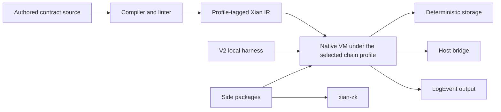

# xian-contracting

`xian-contracting` is the contract compiler, source/artifact utility layer,
local test harness, and standard-library bridge for Xian. Network execution is
defined by the chain's Xian VM profile. The fresh-genesis profile is `xian_vm_v2`.

The published PyPI package is `xian-tech-contracting`. The import package
remains `contracting`. Side packages under `packages/` (deterministic runtime
types, accounts, fast-path validator, VM crates, zk tooling)
are released independently and consumed by `xian-abci`, `xian-py`, and the
node runtime.

## Package Shape



## Quick Start

From this checkout, install the local compiler, matching runtime types and V2
VM with Python 3.14:

```bash
uv sync
```

The base installation includes the native VM, compiler and runtime types. Add
the `zk` extra for the optional zk helpers.

Compile artifacts for the fresh-genesis profile:

```python
from contracting.artifacts import build_contract_artifacts

contract_source = "@export\ndef half(amount: decimal):\n    return amount / 2"
artifacts = build_contract_artifacts(module_name="con_math", source=contract_source)
```

Run the same source under the native V2 VM. The local harness compiles
deployments and executes constructors, exported functions and cross-contract
calls. Fractional Python inputs use `decimal.Decimal`.

```python
from decimal import Decimal
from tempfile import TemporaryDirectory
from contracting.local import ContractingClient

with TemporaryDirectory() as home:
    with ContractingClient(storage_home=home) as client:
        client.submit(contract_source, name="con_math")
        result = client.get_contract_proxy("con_math").half(amount=Decimal("0.25"))
        assert result == Decimal("0.125")
```

`submit` accepts source text or a Python function containing the contract
definition. `ContractingClient` supports only `xian_vm_v2`, the execution
profile selected by fresh-chain validators. It rejects an explicit V1 profile
or a supplied V1 driver with `ValueError`.
Use a fresh V2 storage directory for local tests.

Local clients use the canonical compiler and do not accept a `compiler=`
override. Use `compile_contract_source` or `build_contract_artifacts` from
`contracting.artifacts` to compile offline. Native V1 compilation, encoding,
storage and low-level VM bindings are reserved for historical verification and
migration tools. They do not provide a supported V1 local client. The Python
package does not execute contracts through CPython or expose a Python-bytecode
compiler. See the [compatibility guide](tests/compatibility/README.md) for pinned
historical observations and their capture procedure.

## Principles

- **Contracts use Python syntax, but are not general Python.** Execution rules
  are consensus-sensitive and intentionally narrower than the host language.
- **Consensus parity comes first.** Metering, storage encoding, import
  restrictions, and runtime helpers must stay version-aligned across all
  validators.
- **The Xian VM is the execution target.** Validators accept cleartext source
  and derive canonical Xian VM IR themselves before persisting deployed state.
- **Compiler and harness stay distinct.** SDKs and CLI deployment flows submit
  source. Offline artifacts are useful for diagnostics and CI, but are not the
  public deployment payload.
- **Compilation is bounded.** The Rust compiler admits at most 128 KiB source,
  50,000 syntax nodes, syntax depth 64, 100,000 tokens total, 4,096 tokens on
  one logical line, 1 MiB of canonical IR JSON, and 512 contract-handle
  inference passes. Every binding returns the same `xian.limit.*` diagnostic.
- **Stay scoped.** Built-in helpers serve the execution model. They do not grow
  into a general convenience framework.
- **No node orchestration here.** Operator workflow, genesis distribution, and
  container lifecycle belong in `xian-abci`, `xian-cli`, and `xian-stack`.
- **Security-sensitive.** Favor small, well-tested changes. If a fix changes
  execution semantics, add regression tests in the same change.

## Key Directories

- `src/contracting/` — compiler, artifacts, local harness, storage, and stdlib
  bridge.
  - `artifacts/` — public source compiler, artifact builder, and validator.
  - `compilation/` — parser, compiler, linter, and whitelist logic.
  - `compiler/` — public compiler import surface.
  - `execution/` — shared native host context and execution errors.
  - `local/` — high-level `ContractingClient` for local tests and tooling.
  - `storage/` — drivers, ORM helpers, encoder, and LMDB-backed state.
  - `contracts/` — package-local contract assets (e.g. the built-in submission
    contract).
  - `stdlib/` — contract-side standard-library bridge.
- `packages/` — independently released sibling packages:
  `xian-accounts`, `xian-compiler-core`, `xian-runtime-types`, `xian-vm-core`,
  `xian-zk`; plus the Rust-only crates `xian-numeric` and
  `xian-fastpath-core` (transaction admission rules) that `xian-vm-core` links.
- `scripts/` — audit and fixture-generation tools used by VM/runtime work.
- `tests/` — `unit/`, `integration/`, `security/`, `performance/` coverage.
- `examples/` — notebook walk-throughs and a non-Jupyter validation script.
- `docs/` — architecture, backlog, current-state notes, and active design drafts.

## What This Runtime Covers

- compilation and linting of contract source
- local harness execution, metering, and import restrictions
- storage drivers and encoding
- contract-side runtime helpers (`stdlib` bridge)
- native V2 local clients
- native zero-knowledge verifier building blocks
- Xian VM IR generation, validation, native execution and compatibility fixtures

## Validation

Default CI runs the Python suite with the required Rust compiler extension:

```bash
uv sync --group dev
uv run ruff check .
uv run ruff format --check .
uv run pytest --cov=contracting --cov-report=term-missing --cov-report=xml
```

The default `pytest` config deselects the larger corpus marked
`optional_native`. The native/release path selects that corpus and installs
additional packages needed by checks such as the optional zk integrations.

Native / release CI path:

```bash
./scripts/validate-release.sh
```

`validate-release.sh` runs the default suite plus compiler-core, zk, and VM
checks, the WASM compiler package build, optional-native parity and fuzz
coverage, and the Rust-side package checks used by release CI. It is the gate
for tagging a release.

The [published application corpus](tests/compatibility/applications/README.md)
compares bounded token, nameservice, staking and DEX workflows with a pinned
pre-VM Python capture. Run it against an already installed native runtime:

```sh
python tests/compatibility/application_runner.py --engine native-metered --check
```

These are authored workflows over unchanged historical sources, not historical
chain transactions. Two documented constructor-context and square-root policy
differences have exact expected values; all other observations compare strictly.
The [compatibility guide](tests/compatibility/README.md) also describes the
separate language-level corpus and historical capture procedure.

The [determinism campaign](tests/determinism/README.md) compares exact metered
native observations across fresh-process perturbations and supported platforms.
It includes the full reviewed surface corpus, seeded generated stateful programs,
semantic oracles, rollback and reopen checks. Run a larger local campaign with:

```sh
uv run --no-sync python -m tests.determinism.campaign \
  --output .artifacts/determinism-run --seed 20261103 --generated 256 --extended
```

If you change metering, tracing, storage encoding, or import restrictions,
treat the change as consensus-sensitive and run the relevant `tests/security/`
and `tests/integration/` paths explicitly.

## Related Docs

- [AGENTS.md](AGENTS.md) — repo-specific guidance for AI agents and contributors
- [docs/README.md](docs/README.md) — index of internal design notes
- [docs/ARCHITECTURE.md](docs/ARCHITECTURE.md) — major components and dependency direction
- [docs/BACKLOG.md](docs/BACKLOG.md) — open work and follow-ups
- [docs/COMPILER_RELEASE.md](docs/COMPILER_RELEASE.md) — compiler package validation and publish order
- [docs/SAFETY_INVARIANTS.md](docs/SAFETY_INVARIANTS.md) — invariants the runtime must preserve
- [docs/COMPILE_TIME_EXTENDS.md](docs/COMPILE_TIME_EXTENDS.md) — contract import / extends model
- [docs/EXECUTION_BACKLOG.md](docs/EXECUTION_BACKLOG.md) — execution-engine follow-ups
- [docs/SHIELDED_STATE_REDESIGN_V2.md](docs/SHIELDED_STATE_REDESIGN_V2.md) — shielded-state model
- [docs/ZK_PRIVACY_OPTIMIZATION_PLAN.md](docs/ZK_PRIVACY_OPTIMIZATION_PLAN.md) — zk privacy roadmap
