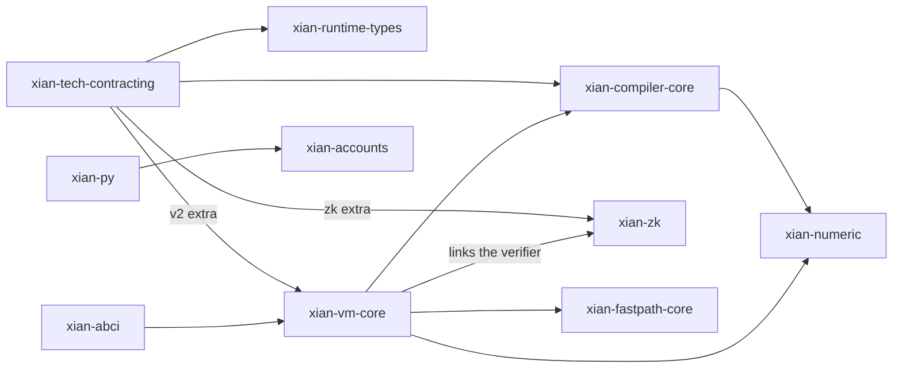

# Packages

This folder contains smaller publishable packages shared by the Xian runtime
and node stack. They stay separate so `xian-tech-contracting` can depend on
small, purpose-built packages instead of growing one monolithic runtime.

## Contents

- `xian-numeric/`: exact V2 decimal input grammar and bounds shared by the Rust compiler and VM
- `xian-runtime-types/`: deterministic shared value types and encoding
- `xian-accounts/`: shared signing and account primitives
- `xian-compiler-core/`: shared Rust/WASM compiler core, published as
  `xian-tech-compiler-core`
- `xian-fastpath-core/`: Rust crate with transaction wire decoding and the static
  admission rules; `xian-vm-core` links it and exposes admission to the node
- `xian-vm-core/`: native `xian_ir_v1` validation (V1 and V2) and the V2
  execution engine (blocks and single calls), published as `xian-tech-vm-core`
- `xian-zk/`: native Groth16 BN254 verification and shielded-note proving
  toolkit, published as `xian-tech-zk`

## Notes

Keep these packages small and purpose-built. Shared code belongs here only when
it has a clear runtime/node boundary and an independent package surface.

`xian-vm-core` links the `xian-compiler-core` and `xian-zk` crates. Both are
also Python extensions (`cdylib` and `rlib`), so building the VM writes
featureless copies of their libraries into the VM's Cargo target directory.
Build their Python packages with their own target directories (or install the
VM with `--no-deps`); a shared target directory can install the featureless
library (`ImportError: ... PyInit__native`).
