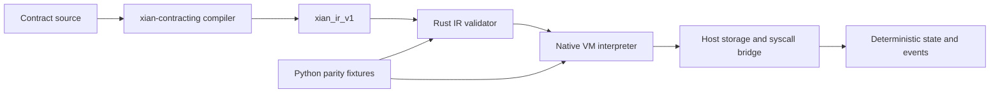

# xian-vm-core

`xian-vm-core` is the Rust-side consumer of the versioned `xian_ir_v1` contract IR emitted by the Xian compiler.

Supported scope:

- deserialize the structural JSON IR
- validate its top-level invariants and recursive node shapes
- instantiate validated modules and execute their IR using the chain-selected numeric rules
- provide one Rust-owned contract for the Python frontend to target
- expose a minimal Python-facing native capability surface for `xian-abci`
  probing via `xian_vm_core._native`

## Numeric profiles

The chain selects a profile for artifact admission and execution. Every module
in a call uses that profile. `runtime_info(vm_profile="xian_vm_v2")` reports
execution revision `xvm-execution-8`, bytecode version `xvm-2` and gas schedule
`xvm-gas-3`. The native and Python host bindings select V2 by default. Public
`ContractingClient` and `ParallelBatchExecutor` execution accepts only V2.

Low-level native V1 supports historical verification and migration: select
`vm_profile="xian_vm_v1"` explicitly on its driver and execution entrypoint.
V1 retains execution revision `xvm-execution-7`, bytecode version `xvm-1` and
gas schedule `xvm-gas-2`. Both profiles share the documented resource bounds;
replaying earlier execution semantics requires the corresponding pinned runtime.

V2 external entrypoints must be exported functions. Constructors execute only
through trusted deployment. Code-hash inspection accepts only the `runtime`,
`ir` and `source` selectors; other kinds fail. Archival V1 semantics remain
separate from these V2 checks.

F-string output is limited to 128 KiB in UTF-8 bytes across the complete result, including literal text and every interpolated field. The VM checks each append before allocating the aggregate output.

Each transaction permits at most 128 active interpreter frames. Function entry, recursive expression and block evaluation, comprehension generators, assignment traversal and lazy iterator advancement share this bound across contracts, module initialization and constructors. The bound also applies without chi metering. Exceeding it returns an execution error and rolls back transaction effects; frames unwind so later executions can proceed.

V2 integers have a maximum magnitude of 512 bits. Fixed decimals have 30 fractional places and magnitude below `10**61`. Fractional literals carry exact decimal text. Numeric `/` returns a decimal, truncating toward zero at the smallest representable unit. Decimal multiplication uses the same rule. Integer `//` rounds down and `%` follows the divisor's sign. Integer exponentiation requires a nonnegative integer exponent. Boolean values are distinct from numbers.

`quantize(value, places, mode)` supports 0 through 30 places with `toward_zero`, `floor`, `ceil` and `half_even`. `sqrt(value)` returns the floor of the square root on the decimal grid. `mul_div_floor(a, b, d)` and `mul_div_ceil(a, b, d)` use an exact intermediate integer product and require a positive divisor. The bounded numeric formatter truncates discarded decimal places toward zero. Apply `quantize` first to select a different display rounding mode. Native binary floats and raw Python Decimal intermediates are rejected. Fixed decimal values and large integers use exact tagged JSON at the network boundary.

## V1 execution coverage

- local function calls and builtin calls such as `len`, `range`, `str`, and
  `isinstance`
- aggregate/container helpers such as `sorted`, `sum`, `min`, `max`, `all`,
  `any`, `reversed`, and `zip`
- explicit storage ops for `Variable` and `Hash`
- foreign storage reads for `ForeignVariable` and `ForeignHash`, including
  function-local references with dynamic contract/variable targets
- arbitrary-precision integer values instead of `i64`-only VM integers
- fixed-precision `decimal(...)` construction and arithmetic
- raw Decimal results from explicit-digit rounding: general powers, non-finite
  in-memory values, exact float conversion, all 53 historically reachable public
  methods, and DecimalTuple named results; see the
  [compatibility contract](../../tests/compatibility/README.md) for context,
  storage, set ordering and resource bounds
- native `datetime.datetime` / `datetime.timedelta` values, including
  `datetime.datetime.strptime(...)`, arithmetic, comparison, and common field
  access
- bigint-oriented builtins needed by the shielded contracts, including
  `int(..., base)`, `pow(base, exp, mod)`, and `format(value, "064x")`
- `hashlib.sha3(...)` and `hashlib.sha256(...)`
- `crypto.verify(...)` and `crypto.key_is_valid(...)`
- `LogEvent` emission
- static-import and dynamic-import contract export calls
- native container method calls used by contracts today, including
  `dict.keys()`, `dict.values()`, `dict.items()`, `dict.get()`, and the common
  mutable list helpers `append`, `extend`, `insert`, `remove`, and `pop`
- native string helpers used by the shielded contracts, including
  `lower()`, `isalnum()`, `startswith(...)`, and `join(...)`
- Python-style subscript slicing for `list`, `tuple`, and `str`, including
  the `value[2:]` helper pattern used in the shielded contracts
- sequence repetition for `list`, `tuple`, and `str`
- host-delegated `zk.*` syscalls, which remain explicit runtime boundary calls
  instead of Rust-local protocol logic

It is a bounded execution slice, not the full executor.

Contract ownership is enforced on both direct transactions and cross-contract
calls. A non-null stored owner must match the immediate caller: the sender for
an entry call, or the calling contract for a nested call. Unowned contracts
remain publicly callable.

Only the currently executing `submission` contract may deploy contracts or
change owner/developer metadata. Constructors and other user contracts cannot
invoke those privileged syscalls directly. An owning contract can call
`submission.change_owner`; the submission contract still checks its immediate
caller before applying the change. Developer changes use the same pattern.

These ownership and metering rules affect transaction outcomes and charges.
Validators must activate a runtime version with these rules together.

Custom `importlib.enforce_interface` predicates receive an immutable
`InterfaceSubject` containing only `kind`, `name`, `args` and `storage_type`.
Function arguments are positional-name tuples; storage types are family-name
strings. The subject never contains a live foreign callable, storage handle or
class. Standard Func/Var matchers accept it for delegation. Local predicates
run in the inspecting contract's frame under the ordinary transaction budget;
their result is tested for truthiness and errors propagate normally. Missing or
None members and ordinary values retain their existing callback-free behavior.
Subjects cannot be persisted, exposed as public results or passed between
contracts. See the [surface coverage contract](../../tests/surface/README.md#metadata-only-interface-predicates)
for the exact fields and complementary boundary tests.

The crate includes curated historical Python observations with pinned
provenance, plus independent semantic expectations and model-based tests. Rust
checks preserve those expected results without executing a maintained Python
contract engine or deriving oracle values from the VM under test.

Metering covers both host-side data costs and VM execution:

- one transaction budget is shared by the entry executor, host operations, and
  every serial or nested constructor; starting a constructor never resets it
- metered execution uses the supplied raw-chi budget capped at 50,000,000,000;
  a zero budget uses that cap, while explicitly unmetered execution remains
  available for trusted local tooling
- failed execution discards writes and events but retains measured work and
  contract cost attribution, including failed constructors
- storage reads, writes, transaction bytes, and return-value bytes are charged
  directly in the VM host path
- execution cost is driven by an explicit `xian_vm_v1` gas schedule over VM
  statements, expressions, calls, and loop iterations
- module initialization is metered, so first-load authored contracts do not get
  free global-declaration and module-body execution
- `contract.exists(...)`, `contract.has_export(...)`, `contract.info(...)`, and
  related contract metadata syscalls resolve directly against the driver/IR in
  the native host bridge
- authored contract storage persists `__xian_ir_v1__`, and the native host
  requires that validator-derived artifact for `xian_vm_v1` execution; stored
  `__source__` remains available for dashboards, BDS, and other inspection
  tooling
- native deployment accepts cleartext source only, rejects submitted
  `deployment_artifacts`, and derives `vm_ir_json` through the pinned compiler
  before staging writes
- native deployment requires explicit deterministic `now` context from the
  caller; the host does not fall back to local wall-clock time for submission
  metadata
- the native deployment path validates the compiler-produced IR before staging
  writes or executing constructors
- source deployment and offline artifact tooling use the canonical Rust
  compiler and validate source-to-IR identity; the host bridge does not compile
  or execute contract source as Python bytecode
- the five-node `make localnet-parallel-e2e` native-authority soak passes end to
  end, including shielded token flows and parallel prefix-scan access patterns

That parity corpus covers:

- storage/event flows
- range/list/dict control-flow helpers
- foreign storage reads
- fixed-precision decimal semantics
- datetime/timedelta behavior
- bigint parsing, modular arithmetic, hex formatting, and shielded-style helper
  flows
- hashing and ed25519 verification helpers
- static-import and dynamic-import nested contract calls
- real authored shielded contract sources for `shielded-note-token` and
  `shielded-commands`, including constructor-seeded state snapshots and
  hash-helper exports
- real authored token, registry, game, and oracle flows across repos, including:
  `currency.transfer(...)`, `stable_token.burn(...)`,
  `reflection_token.transfer(...)`, `profile_registry.create_channel(...)`,
  `turn_based_games.join_match(...)`, and `oracle.price_info(...)`

The Xian VM and canonical compiler are Rust-owned. Independent semantic models
and pinned historical evidence define checks on observable execution behavior;
host-language implementation details are not a language specification.

The crate ships a small PyO3/maturin surface for integration work:

- `runtime_info()` / `runtime_info_json()`
- `supports_execution_policy(...)`
- `validate_module_ir(...)` / `validate_module_ir_json(...)`

Node-side code uses the capability surface to check exact runtime policy before
executing transactions through the Rust engine. Python-facing execution also
provides low-level native bindings for archival V1 tools.

The largest remaining runtime work is metering drift on the heaviest authored
flows and the host-operation split between delegated calls and Rust-owned
implementations. Integer width, basic authored shielded execution, and
pre-call setup flows are covered by the authored parity corpus and fixture
generator.

## Releases

Push a `vm-core-vX.Y.Z` tag with matching versions in `pyproject.toml` and
`Cargo.toml` after `../../scripts/validate-release.sh` passes. The release
workflow builds native wheels for Linux, macOS Intel/ARM and Windows, and a
source distribution. PyPI Trusted Publishing uses project `xian-tech-vm-core`,
owner `xian-technology`, repository `xian-contracting`, workflow `release.yml`
and environment `pypi-xian-vm-core`.

Runtime semantics are consensus-sensitive. Validators must use the same
accepted VM version; existing histories containing previously failed dynamic
foreign-storage calls need an explicit upgrade boundary.

## Local VM diagnostics

Setting `XIAN_VM_TRACE_CALLS` or `XIAN_VM_TRACE_STATEMENTS` enables best-effort
UTC diagnostic lines on stderr. Records contain bounded contract/function names,
operation kinds, success/error status and the process ID for worker correlation.
They omit caller/signer identifiers,
arguments, return values, storage contents and exception text. Diagnostic sink
errors are ignored so a closed stderr cannot change execution results or chi.
These timestamps are operator metadata; they are never part of VM outputs.
