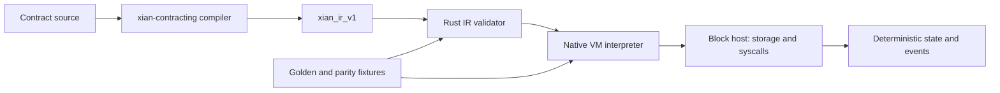

# xian-vm-core

`xian-vm-core` is the Rust-side consumer of the versioned `xian_ir_v1` contract IR emitted by the Xian compiler.

Supported scope:

- deserialize the structural JSON IR
- validate its top-level invariants and recursive node shapes
- instantiate validated modules and execute their IR using the chain-selected numeric rules
- provide one Rust-owned contract for the Python frontend to target
- run transactions for the node (`BlockExecutor` for blocks, `execute_tx` for
  one call) and expose the Python-facing surface `xian-abci` and
  `contracting` use via `xian_vm_core._native`

## Numeric profiles

The chain selects a profile for artifact admission and execution. Every module
in a call uses that profile. `runtime_info(vm_profile="xian_vm_v2")` reports
execution revision `xvm-execution-14`, bytecode version `xvm-2` and gas schedule
`xvm-gas-6`. Every execution entry point runs V2; `runtime_info` and
`supports_execution_policy` know only `xian_vm_v2`. V1 IR still validates (for
migration and archival tooling), but current code does not execute V1;
replaying earlier execution semantics requires the corresponding pinned
release.

V2 external entrypoints must be exported functions. Constructors execute only
through trusted deployment. Code-hash inspection accepts only the `runtime`,
`ir` and `source` selectors; other kinds fail.

V2 failures carry their exception type and arguments as structured data from
the VM, including exceptions raised by a constructor during deployment and
builtin exceptions raised by host syscalls. The failure text is never parsed:
contract data inside a message cannot select an exception type, and a failure
without structured data remains an opaque message.

V2 `Hash.all(*prefix)` and `Hash.clear(*prefix)` select the whole hash only
when called without arguments; `""` is an ordinary first dimension. V2
`crypto.key_is_valid` accepts exactly 64 lowercase hex characters.

`xvm-gas-5` charges element work: every value comparison (including identical
members) and dictionary key probe, every member of a container that is copied
or allocated, and every node of a value passed across a contract boundary costs
one unit of 24 raw chi, in addition to the operation's own gas. Text and binary
payloads count by size: one unit per 64 bytes copied, per 128 bytes compared
(`==`, `<`, sorting), per 8 bytes searched or copied by a string operation
(`find`, `count`, `in`, `replace`, `split(sep)`, `join`, slicing, indexing,
`decimal(text)`), and per 2 bytes of per-character work (`upper`, `lower`,
`isalpha`, `isdigit`, `islower`, `isalnum`, `split()`, `int(text)`). Each entry a
whole-hash scan (`Hash.all`, `clear`, `clone_from`) visits costs 2,560 raw chi
on top of its read bytes. Pending element work is charged before the next
expression or statement; one operation may perform at most 2^20 units before it
is charged, and exceeding that fails the transaction. CPU time per charged chi
of every operation family stays within a small constant factor of plain
interpreter work (`tests/metering_bounds.rs`, `scripts/metering_calibration.py`).

`xvm-gas-6` (`xvm-execution-12`) gives V2 dictionaries a hash index. A lookup,
membership test, `get`, insert, overwrite, `setdefault`, `update` entry, `pop` or
`popitem` hashes the key (one unit per key node and per 8 payload bytes),
compares the key only with entries of the same hash (one unit each, as before)
and changes the dictionary in place, so its cost no longer grows with the
dictionary. Removing an entry also costs one unit per 16 later entries it moves
up. Dictionary displays, comprehensions, `dict()`, `fromkeys()` and `|` build
through the same index. Insertion order, the retained first key, iteration and
the errors are unchanged. Equal keys hash equally under V2 equality: integers
by value (`True` and `1` are different V2 keys), text and bytes by payload,
tuples by their items and frozensets by their size.

`xvm-execution-13` bounds V2 storage keys by what the node's store can hold:
LMDB 0.9 stores keys of at most 511 bytes (`MAX_STORAGE_KEY_BYTES`). A V2
write whose whole key (`contract.variable` or `contract.hash:key`, in UTF-8
bytes) is longer fails the transaction at the write, with `Storage key is too
long (N bytes). Max is 511.`; this covers `Variable.set`, hash assignment and
`clone_from`, including constructor writes during deployment. A hash key
longer than 511 bytes is invalid for reads as well; a lookup whose hash key
fits but whose whole key is longer finds nothing. Before this revision such a
write succeeded during execution and only LMDB refused it when the block
committed. The storage driver refuses to stage a longer key in every
profile. Gas is unchanged (`xvm-gas-6`). V2 contract admission (`xian-admission-3`,
compiler-core `xian.lint.E024`) rejects a storage declaration whose
`contract.name` key (plus `:` for a hash) could exceed the limit under the
longest, 64-byte contract name: variable names may have 446 bytes and hash
names 445, so only hash entry keys can exceed it at runtime.

`xvm-execution-14` reads a `{"__delta__": ...}` wrapper only as the encoder
writes it: an array of exactly two safe integers `[days, seconds]`, as the
stored-value reader already did. Before this revision the V2 wire decoder also
took a two-character string (`"12"`, including non-ASCII digits) or the two
keys of an object, fed through `int()`; a transaction with an argument spelled
that way is now not canonical and is not admitted, where it used to run with a
timedelta. `{"__time__": ...}`
likewise takes only an array of three to seven safe integers. The block
executor now settles writes and events holding a timedelta or a bytearray
itself instead of handing them to Python, which failed them before this
revision (receipts had no form for either). Gas is unchanged
(`xvm-gas-6`).

One V2 transaction may use at most 1,000,000 chi (`max_tx_chi` in
`runtime_info()`); a larger or zero budget is capped there. Node fee policies set
their per-transaction caps at or below this ceiling.

F-string output is limited to 128 KiB in UTF-8 bytes across the complete result, including literal text and every interpolated field. The VM checks each append before allocating the aggregate output.

Each transaction permits at most 128 active interpreter frames. Function entry, recursive expression and block evaluation, comprehension generators, assignment traversal and lazy iterator advancement share this bound across contracts, module initialization and constructors. The bound also applies without chi metering. Exceeding it returns an execution error and rolls back transaction effects; frames unwind so later executions can proceed.

V2 integers have a maximum magnitude of 512 bits. Fixed decimals have 30 fractional places and magnitude below `10**61`. Fractional literals carry exact decimal text. Numeric `/` returns a decimal, truncating toward zero at the smallest representable unit. Decimal multiplication uses the same rule. Integer `//` rounds down and `%` follows the divisor's sign. Integer exponentiation requires a nonnegative integer exponent. Boolean values are distinct from numbers.

`quantize(value, places, mode)` supports 0 through 30 places with `toward_zero`, `floor`, `ceil` and `half_even`. `sqrt(value)` returns the floor of the square root on the decimal grid. `mul_div_floor(a, b, d)` and `mul_div_ceil(a, b, d)` use an exact intermediate integer product and require a positive divisor. The bounded numeric formatter truncates discarded decimal places toward zero. Apply `quantize` first to select a different display rounding mode. Native binary floats and raw Python Decimal intermediates are rejected. Fixed decimal values and large integers use exact tagged JSON at the network boundary.

## Node storage

The node's state lives in one LMDB environment per directory, opened through
`xian_vm_core.LmdbEnvironment` (LMDB 0.9.37 vendored under `vendor/lmdb`).
`contracting.storage` uses it for every read and write; the py-lmdb package is
only used by contracting's tests that prove file and lock compatibility.

The block's pending writes live in `xian_vm_core.BlockState` (`src/block_state.rs`),
owned by the contracting `Driver`: a key-ordered map from key to the stored value
bytes LMDB will hold (or a pending deletion), the current transaction's tracked
reads, and one discarding scope that undoes a transaction's changes. A commit
writes the bytes unchanged in one LMDB transaction and clears the overlay only
when the write succeeded.

Under V2 the VM reads contract state itself: a `Variable` or `Hash` key is read
from the block overlay, else from LMDB, and decoded in Rust
(`src/stored_value.rs`), giving the same value Python's `decode` gives; keys the
transaction's own host syscalls staged are read from its host writes first. A
stored value the reader rejects is a host fault (`LmdbStorageError`), never a
transaction outcome. Tooling that hashes or stores values outside execution
uses `stored_value_bytes(value)`, the bytes `BlockState.write_value` stores.

## Execution coverage

- local function calls and builtin calls such as `len`, `range`, `str`, and
  `isinstance`
- aggregate/container helpers such as `sorted`, `sum`, `min`, `max`, `all`,
  `any`, `reversed`, and `zip`
- explicit storage ops for `Variable` and `Hash`
- foreign storage reads for `ForeignVariable` and `ForeignHash`, including
  function-local references with dynamic contract/variable targets
- arbitrary-precision integer values instead of `i64`-only VM integers
- fixed-precision `decimal(...)` construction and arithmetic
- native `datetime.datetime` / `datetime.timedelta` values, including
  `datetime.datetime.strptime(...)`, arithmetic, comparison, and common field
  access
- bigint-oriented builtins needed by the shielded contracts, including
  `int(..., base)`, `pow(base, exp, mod)`, and `format(value, "064x")`
- `hashlib.sha3(...)` and `hashlib.sha256(...)`
- `crypto.verify(...)` and `crypto.key_is_valid(...)`
- `LogEvent` emission
- static-import and dynamic-import contract export calls
- native container method calls used by contracts today, including
  `dict.keys()`, `dict.values()`, `dict.items()`, `dict.get()`, and the common
  mutable list helpers `append`, `extend`, `insert`, `remove`, and `pop`
- native string helpers used by the shielded contracts, including
  `lower()`, `isalnum()`, `startswith(...)`, and `join(...)`
- Python-style subscript slicing for `list`, `tuple`, and `str`, including
  the `value[2:]` helper pattern used in the shielded contracts
- sequence repetition for `list`, `tuple`, and `str`
- the `zk.*` syscalls: this crate links `xian-zk` (every node verifies zk
  proofs). The block host serves them in Rust, reads verifying keys from
  `zk_registry` in chain state, and verifies through the node's proof caches
  (`zk_cache`: prepared keys and verified results of registered keys), which
  the node's proof pre-verification (`zk_warm_registered`) fills. Contract preparation,
  `has_export` and deployments refuse a contract using zk while the chain's
  zk runtime feature is off, as ordinary failures.

Contract ownership is enforced on both direct transactions and cross-contract
calls. A non-null stored owner must match the immediate caller: the sender for
an entry call, or the calling contract for a nested call. Unowned contracts
remain publicly callable.

Only the currently executing `submission` contract may deploy contracts or
change owner/developer metadata. Constructors and other user contracts cannot
invoke those privileged syscalls directly. An owning contract can call
`submission.change_owner`; the submission contract still checks its immediate
caller before applying the change. Developer changes use the same pattern.

These ownership and metering rules affect transaction outcomes and charges.
Validators must activate a runtime version with these rules together.

Custom `importlib.enforce_interface` predicates receive an immutable
`InterfaceSubject` containing only `kind`, `name`, `args` and `storage_type`.
Function arguments are positional-name tuples; storage types are family-name
strings. The subject never contains a live foreign callable, storage handle or
class. Standard Func/Var matchers accept it for delegation. Local predicates
run in the inspecting contract's frame under the ordinary transaction budget;
their result is tested for truthiness and errors propagate normally. Missing or
None members and ordinary values retain their existing callback-free behavior.
Subjects cannot be persisted, exposed as public results or passed between
contracts. See the [surface coverage contract](../../tests/surface/README.md#metadata-only-interface-predicates)
for the exact fields and complementary boundary tests.

The crate includes curated historical Python observations with pinned
provenance, plus independent semantic expectations and model-based tests. Rust
checks preserve those expected results without executing a maintained Python
contract engine or deriving oracle values from the VM under test.

Metering covers both host-side data costs and VM execution:

- one transaction budget is shared by the entry executor, host operations, and
  every serial or nested constructor; starting a constructor never resets it
- metered execution uses the supplied budget capped at the profile's ceiling
  (1,000,000 chi); a zero budget uses that cap, while explicitly unmetered execution remains available for trusted
  local tooling
- failed execution discards writes and events but retains measured work and
  contract cost attribution, including failed constructors
- storage reads, writes, transaction bytes, and return-value bytes are charged
  directly in the VM host path
- execution cost is driven by the explicit gas schedule (`xvm-gas-6`) over VM
  statements, expressions, calls, and loop iterations
- module initialization is metered, so first-load authored contracts do not get
  free global-declaration and module-body execution
- `contract.exists(...)`, `contract.has_export(...)`, `contract.info(...)`, and
  related contract metadata syscalls resolve directly against chain state and
  IR in the block host
- authored contract storage persists `__xian_ir_v1__`, and the block host
  requires that validator-derived artifact for execution; stored
  `__source__` remains available for dashboards, BDS, and other inspection
  tooling
- native deployment accepts cleartext source only, rejects submitted
  `deployment_artifacts`, and derives `vm_ir_json` through the pinned compiler
  before staging writes
- native deployment requires explicit deterministic `now` context from the
  caller; the host does not fall back to local wall-clock time for submission
  metadata
- the native deployment path validates the compiler-produced IR before staging
  writes or executing constructors
- source deployment and offline artifact tooling use the canonical Rust
  compiler and validate source-to-IR identity; the block host does not compile
  or execute contract source as Python bytecode
- the five-node localnet e2e native-authority soak passes end to end, including
  shielded token flows and prefix-scan access patterns

That parity corpus covers:

- storage/event flows
- range/list/dict control-flow helpers
- foreign storage reads
- fixed-precision decimal semantics
- datetime/timedelta behavior
- bigint parsing, modular arithmetic, hex formatting, and shielded-style helper
  flows
- hashing and ed25519 verification helpers
- static-import and dynamic-import nested contract calls
- real authored shielded contract sources for `shielded-note-token` and
  `shielded-commands`, including constructor-seeded state snapshots and
  hash-helper exports
- real authored token, registry, game, and oracle flows across repos, including:
  `currency.transfer(...)`, `stable_token.burn(...)`,
  `reflection_token.transfer(...)`, `profile_registry.create_channel(...)`,
  `turn_based_games.join_match(...)`, and `oracle.price_info(...)`

The Xian VM and canonical compiler are Rust-owned. Independent semantic models
and pinned historical evidence define checks on observable execution behavior;
host-language implementation details are not a language specification.

The crate ships a small PyO3/maturin surface for integration work:

- `runtime_info()` / `runtime_info_json()`
- `supports_execution_policy(...)`
- `validate_module_ir(...)` / `validate_module_ir_json(...)`
- `decode_and_validate_transaction(raw, chain_id)`: transaction admission
- `BlockExecutor`: a block's transactions from their wire bytes, with fees,
  rewards and receipts
- `execute_tx(environment, overlay, ...)`: one call by the block executor's
  rules over any `BlockState` (pass `overlay.snapshot()` to drop the
  effects); the simulator, contract views, genesis deploys and the local
  `ContractingClient` use it
- `LmdbEnvironment`, `BlockState`, `StateRootTree`, `state_root_leaf_hash`,
  `stored_value_bytes(value)`
- `validated_chi_rate(value)`: the chain chi rate rule (a positive integer
  whose fee arithmetic is representable), which admission, genesis building
  and state patches apply before the executor would refuse the rate

Node-side code uses the capability surface to check exact runtime policy before
executing transactions through the Rust engine. There is no Python execution
host.

The largest remaining runtime work is metering drift on the heaviest authored
flows and the host-operation split between delegated calls and Rust-owned
implementations. Integer width, basic authored shielded execution, and
pre-call setup flows are covered by the authored parity corpus and fixture
generator.

## Releases

Push a `vm-core-vX.Y.Z` tag with matching versions in `pyproject.toml` and
`Cargo.toml` after `../../scripts/validate-release.sh` passes. The release
workflow builds native wheels for Linux, macOS Intel/ARM and Windows, and a
source distribution. PyPI Trusted Publishing uses project `xian-tech-vm-core`,
owner `xian-technology`, repository `xian-contracting`, workflow `release.yml`
and environment `pypi-xian-vm-core`.

Runtime semantics are consensus-sensitive. Validators must use the same
accepted VM version; existing histories containing previously failed dynamic
foreign-storage calls need an explicit upgrade boundary.

## Local VM diagnostics

Setting `XIAN_VM_TRACE_CALLS` or `XIAN_VM_TRACE_STATEMENTS` enables best-effort
UTC diagnostic lines on stderr. Records contain bounded contract/function names,
operation kinds, success/error status and the process ID for worker correlation.
They omit caller/signer identifiers,
arguments, return values, storage contents and exception text. Diagnostic sink
errors are ignored so a closed stderr cannot change execution results or chi.
These timestamps are operator metadata; they are never part of VM outputs.
